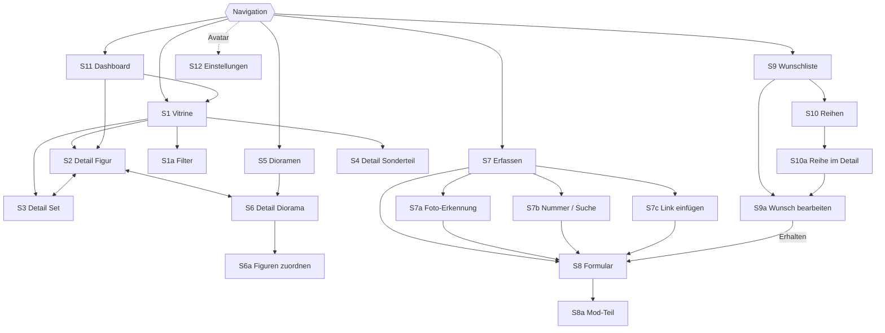

# Stud Stephan – Screens und Abläufe

Stand: 31.10.2026 · Version 1.0 (abgenommen) · Grundlage: `ANFORDERUNGEN.md` v1.0 · Vorlage je Screen: `docs/design/dummy/` (Dateinamen in Klammern)

## 1. Navigation

**Handy:** feste Leiste unten mit fünf Einträgen, in der Mitte der Erfassen-Knopf.

| Vitrine | Dioramen | **＋ Erfassen** | Wunschliste | Dashboard |
|---|---|---|---|---|

**PC:** dieselben Einträge als Seitenleiste links, Inhalt rechts. Die Vitrine nutzt die volle Breite (mehr Spalten). Vorlage: `PC-Vitrine.dc.html`.

**Kopfzeile (überall):** Seitentitel, Suche (Lupe), rechts Avatar → Einstellungen.

## 2. Screens

### S0 Anmeldung (`Anmeldung.dc.html`)
- Logo, E-Mail-Feld, „Anmeldelink senden“. Danach bleibt Stephan auf dem Gerät angemeldet.

### S1 Vitrine (Startseite, `Main.dc.html`)
- Oben: Auswahl Objektart als Chips – Alle · Figuren · Sets · Sonderteile.
- Darunter: Sortierung und Knopf „Filter“ mit Anzahl aktiver Filter.
- Bildraster: große Kacheln (Handy 2 Spalten, PC 5–6). Je Kachel: Foto, Name, Wert. Kleine Marker: „×3“ (mehrere Exemplare), „Mod“ (modifiziert), „Kein Diorama“.
- Gruppen-Kachel (×3) öffnet eine Auswahl der Exemplare, dann S2.
- **Leerer Zustand (erste Nutzung):** Begrüßung und Knopf „Erste Figur erfassen“.

### S1a Filter (`Filter.dc.html`; Bottom-Sheet am Handy, Seitenpanel am PC)
- Thema/Reihe, Hersteller, Zustand (neu/gebraucht), modifiziert ja/nein, ohne Diorama.
- „Zurücksetzen“ und „N Ergebnisse anzeigen“.

### S2 Detail Minifigur (`Figur.dc.html`)
Reihenfolge von oben:
1. Fotogalerie (eigene Fotos, Katalogbild als letztes), wischbar.
2. Name, Katalognummer, Hersteller, Thema/Reihe; Marker Zustand und „Modifiziert“.
3. **Wert-Karte:** aktueller Wert groß, darunter Kaufpreis und Differenz, Mini-Verlauf, Preis im anderen Zustand, „Stand vom …“.
4. **Herkunft:** Quelle, Datum, Kaufpreis; „Stammt aus Set“ (verlinkt zu S3, falls in der Sammlung).
5. **Diorama:** Name mit Vorschaubild (verlinkt zu S6) oder Knopf „Einem Diorama zuordnen“.
6. **Modifikationen:** Liste der getauschten Teile mit Position, Anbieter, Preis; Summe „Ausgaben für Mods“.
7. **Weitere Exemplare:** kleine Kacheln der anderen Exemplare (falls vorhanden).
8. Notiz.
- Aktionen (oben rechts / Menü): Bearbeiten · Weiteres Exemplar anlegen · Löschen.

### S3 Detail Set (`Set.dc.html`)
- Fotogalerie, Name, Nummer, Hersteller, Thema, Jahr, Teilezahl.
- Marker Zustand und **Status** (vollständig · Figuren entnommen · zerlegt).
- Wert-Karte wie S2.
- **Enthaltene Figuren:** Raster aller Figuren des Sets; vorhandene farbig und verlinkt, fehlende ausgegraut mit „＋ Wunschliste“.
- Herkunft, Links, Notiz. Aktionen wie S2.

### S4 Detail Sonderteil (`Sonderteil.dc.html`)
- Aufbau wie S2 ohne Modifikationen, Diorama und Exemplare; mit „Art“ (GWP, Sammelmünze, Sonstiges).

### S5 Dioramen (`Dioramen.dc.html`)
- Große Bildkarten (Handy 1 Spalte, PC 3): Foto, Name, „12 Figuren“.
- Oben ein Hinweis-Banner: „37 Figuren haben noch kein Diorama“ → öffnet die Vitrine mit diesem Filter.

### S6 Detail Diorama (`Diorama.dc.html`)
1. Fotogalerie, groß.
2. Name, Teilezahl, Links (Rebrickable usw.).
3. **Figuren in diesem Diorama:** Raster, jede verlinkt zu S2; Knopf „Figuren zuordnen“.
4. **Studio-Dateien:** Liste mit Dateiname, Größe, Datum; Herunterladen; „Datei hochladen“.
5. Notiz. Aktionen: Bearbeiten · Löschen.

### S6a Figuren zuordnen (`Zuordnen.dc.html`)
- Suchfeld, Filter „nur ohne Diorama“ (voreingestellt).
- Raster mit Mehrfachauswahl (Häkchen). Figuren aus anderen Dioramen sind markiert („steht in: …“); Auswahl verschiebt sie mit Rückfrage.
- Unten: „N Figuren zuordnen“.

### S7 Erfassen (`Erfassen.dc.html`; Bottom-Sheet am Handy, Dialog am PC)
- Schritt 1 – **Was?** Figur · Set · Sonderteil · Diorama · Wunsch.
- Schritt 2 – **Wie?** Foto · Nummer/Suche · Link · Manuell. (Bei Diorama nur Link und Manuell.)

### S7a Foto-Erkennung (`Foto.dc.html`)
- Kamera (Handy) bzw. Datei wählen (PC), Vorschau des Fotos.
- Ladeanzeige „Wird erkannt …“.
- Ergebnisliste: bis zu 5 Vorschläge mit Katalogbild, Name, Nummer, Trefferquote in Prozent.
- Unten: „Keiner passt“ → S7b mit dem Foto im Gepäck.
- Fehlerfall: „Erkennung gerade nicht erreichbar“ + Knopf „Per Nummer weiter“.

### S7b Nummer / Suche (`Suche.dc.html`)
- Suchfeld mit Live-Ergebnissen (Katalogbild, Name, Nummer, Jahr).
- Kein Treffer → „Manuell anlegen“.

### S7c Link einfügen (`Link.dc.html`)
- Feld für den Link, Knopf „Einfügen aus Zwischenablage“.
- Vorschau der erkannten Felder (Name, Hersteller, Nummer, Teilezahl, Bild); nicht erkannte Felder als „bitte ergänzen“ markiert.
- „Weiter“ → S8.

### S8 Formular (`Formular.dc.html`; Erfassen und Bearbeiten)
- Vorausgefüllte Felder hervorgehoben („aus Katalog übernommen“).
- Abschnitte je nach Objektart: Basisdaten · Zustand/Status · Herkunft · Wert (nur bei manuellem Wert) · Fotos · Modifikationen (nur Figur) · Studio-Dateien (nur Diorama) · Notiz.
- Fotos: aufnehmen/hochladen, Reihenfolge per Ziehen, erstes Foto = Titelbild.
- Speichern-Leiste unten fest; nach dem Speichern → Detailseite.

### S8a Mod-Teil hinzufügen (`ModTeil.dc.html`; Bottom-Sheet)
- Position (Auswahl), Beschreibung, Anbieter, Link, Preis, Verbleib Originalteil.

### S9 Wunschliste (`Wunschliste.dc.html`)
- Oben Umschalter: **Wunschliste** · **Reihen**.
- Liste mit Bild, Name, Priorität (Marker), Zielpreis, Marktpreis.
- Abschnitt ganz oben: „Zielpreis erreicht“ (hervorgehoben).
- Sortierung: Priorität · Preis · Name.

### S9a Wunsch bearbeiten (`Wunsch.dc.html`; Bottom-Sheet)
- Priorität, Zielpreis, gewünschter Zustand, Notiz.
- Knöpfe: „Erhalten“ (→ S8 vorausgefüllt) · Entfernen.

### S10 Reihen (`Reihen.dc.html`)
- Suche über alle offiziellen Themen und Reihen.
- „Meine Reihen“: zuletzt geöffnete Reihen mit Fortschritt (z. B. „34 / 52“ als Balken).

### S10a Reihe im Detail (`Reihe.dc.html`)
- Fortschritt groß („34 von 52 Figuren“).
- Filter: Alle · Fehlen · Vorhanden.
- Raster aller Figuren: vorhanden farbig, fehlend ausgegraut, auf Wunschliste mit Marker.
- Tipp auf fehlende Figur → „Auf die Wunschliste“ (S9a).

### S11 Dashboard (`Dashboard.dc.html`)
- Zeitraum: 3 Monate · 1 Jahr · Gesamt.
- **Gesamtwert** groß mit Verlaufsdiagramm.
- Kacheln: Kaufsumme · Wertdifferenz · Ausgaben für Mods · Objekte ohne Wert.
- Anzahl je Objektart; Verteilung nach Thema/Reihe (Balken).
- Top 10 wertvollste Objekte (verlinkt zu S2/S3).
- „Ohne Diorama“ (Anzahl, verlinkt zur gefilterten Vitrine).
- Fußzeile: „Preise Stand vom …“.

### S12 Einstellungen (`Einstellungen.dc.html`)
- Konto (E-Mail, Abmelden).
- Datenquellen: Status Rebrickable, BrickLink (verbunden ja/nein), Brickognize.
- Preisabruf: letzter Lauf, nächster Lauf, Ergebnis (z. B. „312 aktualisiert, 2 fehlgeschlagen“).
- Datensicherung: Export · Import.
- Über die App (Version).

## 3. Abläufe

### A1 Figur per Foto erfassen
Erfassen → Figur → Foto → Vorschlag wählen → Formular (Zustand, Herkunft, Kaufpreis ergänzen) → Speichern → Detail Figur.

### A2 Bluebrixx-Set per Link
Erfassen → Set → Link → Vorschau prüfen, fehlende Felder ergänzen → Formular → Speichern → Detail Set.

### A3 Figur modifizieren
Detail Figur → Bearbeiten → Modifikationen → „Teil hinzufügen“ → Speichern. Wert bleibt, „Ausgaben für Mods“ steigt.

### A4 Diorama anlegen und bestücken
Erfassen → Diorama → Manuell → Fotos, Studio-Datei hochladen → Speichern → Detail Diorama → „Figuren zuordnen“ → auswählen → Zuordnen.

### A5 Reihe vervollständigen
Wunschliste → Reihen → Reihe suchen → Filter „Fehlen“ → Figur antippen → Priorität und Zielpreis → Auf die Wunschliste.

### A6 Wunsch erfüllt
Wunschliste → Eintrag → Erhalten → Formular vorausgefüllt → Speichern → Eintrag verschwindet, Figur steht in der Vitrine.

### A7 Sammlung bewerten
Dashboard → Zeitraum wählen → wertvollste Objekte → Detail.

## 4. Übergreifende Zustände

- **Laden:** Platzhalter-Kacheln statt Drehrad.
- **Leer:** jede Liste mit Erklärung und passender Aktion.
- **Offline / Dienst nicht erreichbar:** Hinweisleiste oben; Sammlung bleibt lesbar.
- **Löschen:** Rückfrage; danach „Rückgängig“ für einige Sekunden.

## 5. Bewusst nicht in Version 1

- Serienerfassung (Kamera bleibt offen, Foto für Foto erfassen). Stephan erfasst jede Figur einzeln.
